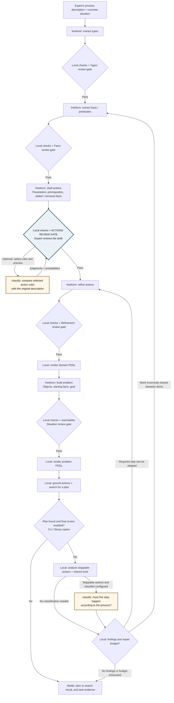
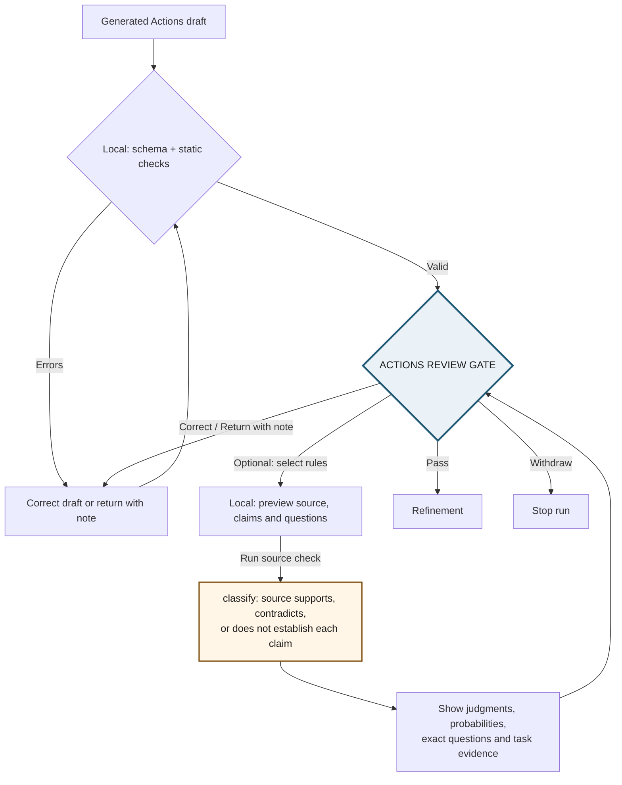

# MoltNet PDDL designer (experimental)

> **When can we trust a generated planning model to represent the process the expert actually described?**

An experimental approach to extracting executable planning models from
natural-language process descriptions.

The pipeline identifies the domain's ontology (types, facts, and actions),
infers action dynamics, and constructs a planning problem from a concrete
situation. Structured validation, source-grounded reviews, and planning help
experts identify incorrect assumptions and refine the model.

Generation runs as contracted tasks on [MoltNet](https://themolt.net), with
explicit human review gates and reproducible artifacts for evaluation.

## Local wizard

Install the Node version in `.tool-versions`, then enable pnpm through Corepack:

```bash
corepack enable pnpm
pnpm install
pnpm db:up
export PDDL_DATABASE_URL=postgresql://designer@127.0.0.1:5440/designer
pnpm db:init
pnpm dev
```

Open `http://127.0.0.1:4317`. The local server serves the UI; a local worker
calls MoltNet. Generation workers run separately (see the
[setup guide](docs/SETUP.md)).
For a built UI, run `pnpm build`, then `pnpm start` and `pnpm worker` in
separate terminals with the same `PDDL_DATABASE_URL`. Saved proofs default
to `runs/`; override with `pnpm dev --runs-dir /path/to/proofs`.

Review extracted meaning alongside numbered source sentences, then Pass,
Correct, Return with note, or Withdraw. Description and construction are
independent Show/Hide panels. The screenshots below use the synthetic Blocks
World browser-test fixture; they demonstrate interaction, not model accuracy.


Step through the plan to inspect typed participants, changed facts and goal
conditions. The description starts collapsed here to give the walkthrough room.


An unfinished live run can be recovered from **Resume current run** on a fresh
page. At its review gate, continue reading or withdraw it before starting another
run. Live runs and review decisions survive server restarts in Postgres. A
worker-claim timeout explains which step was not picked up and offers **Review
setup and retry**. Generated corrections cannot skip earlier saved edits that
still need your approval.

At the Actions review gate, select rules to compare with the description,
preview the request, and run an optional [source check](#source-checks-during-actions-review)
using a classification profile.

## Writing the inputs

The inputs are a process description and a situation. Start with the
[process-elicitation skill](.agents/skills/process-elicitation/SKILL.md) if
you have a story or experience but not yet a structured process. It interviews
the expert one question at a time, distinguishes evidence from assumptions, and
produces a description, situation and test scenarios. The skill includes the
[writing reference](.agents/skills/process-elicitation/references/WRITING-DESCRIPTIONS.md),
whose rules come from observed modeling failures.
`examples/docs-review-guided` follows that guide; `examples/docs-review` is
the same process written without it.

## CLI

Inspect the first stage's task without creating anything:

```bash
pnpm --silent cli \
  --description examples/issue-workflow/description.md \
  --problem examples/issue-workflow/situation.md --dry-run
```

Run all stages. An agent daemon must be draining `freeform` tasks for the same
team and profile, for example `moltnet-agent drain --profile legreffier-pddl-designer-v1`:

```bash
pnpm --silent cli \
  --description examples/issue-workflow/description.md \
  --problem examples/issue-workflow/situation.md \
  --domain-name issue-workflow --problem-name two-issues \
  --team "$TEAM" --diary "$DIARY" --generation-profile legreffier-pddl-designer-v1 \
  --out run.json
```

The run prints a one-line status on stderr and writes the `DesignRun` to
`--out`. Follow the [setup guide](docs/SETUP.md) to connect MoltNet, create the
runtime profile, and start a worker.

### Plan review (optional)

`--review --classification-profile <profile>` re-plans without each step and asks
whether the description requires every step the planner can skip. Each question
is a `classify` task with one `bool` question, served by a profile whose
`models.classification` names a decision model; the task attempt's usage
records the provider and model that answered. A failed question fails the run rather than
passing the plan. A daemon must also be serving `classify` tasks for that
profile. Review is off by default: in live runs its findings have not yet
improved pass rates beyond run-to-run noise.

### Temporal pilot (wizard or CLI)

The [truck-loading example](examples/temporal-loading/README.md) runs the five
modeling stages, asks the temporal-evidence classifier about each action, and
extracts timed clauses for positive actions. Open the wizard with
`?example=temporal-loading` to prefill both inputs and enable temporal
extraction. The wizard and CLI render PDDL 2.1 durative actions and show any
untimed draft facts assigned start/end defaults. Set `PDDL_VAL_PATH` on the
wizard worker, or pass `--val PATH` to the CLI, to check a one-step timed
schedule with VAL. Actions with timing evidence but no usable numeric duration
stay classical and are identified in the result. CLI JSON keeps the normal
run structure, with the timed model under `temporal`.

## Workflow at a glance

The **Actions review gate** is where you inspect the draft action definitions,
compare them with your description, and choose **Pass**, **Correct**, **Return
with note**, or **Withdraw**. It sits **after action generation and local checks,
before Refinement**. The blue node below marks that location.

`freeform` nodes are generation tasks; `classify` nodes are decision-model tasks.
`Local` nodes run in code. Review gates pause for the expert in the wizard;
library callers opt into them with `confirmStage`. The overview includes the
optional final plan review.



Generation retries and the other gates' edit/feedback/withdraw paths are omitted
from this overview. Every generated or edited result is checked; blocking errors
prevent passing. Final-review repairs are bounded and re-enter the normal checks
and gates. The problem is reused only while it remains valid for the new domain.

### Stages

| Stage        | Returns                                                  | Checked by                                                                                                                                              |
| ------------ | -------------------------------------------------------- | ------------------------------------------------------------------------------------------------------------------------------------------------------- |
| `types`      | Types, each with an optional parent                      | Undefined parents, cycles, the reserved root `object`                                                                                                   |
| `predicates` | Facts with typed parameters                              | Unknown parameter types, duplicates                                                                                                                     |
| `actions`    | Draft actions: parameters, preconditions, adds, deletes  | Unknown predicates, arity, non-parameter arguments, type mismatches. Hints: facts no action deletes, parameters no precondition links                   |
| `refine`     | Complete action list and one line per change             | Same as `actions`                                                                                                                                       |
| `problem`    | Objects, initial facts, and goal for the given situation | Undeclared objects; actions whose parameter type has no object; goal facts that can never become true, with the initial facts each blocked action lacks |

A result with errors gets one correction task listing the exact problems
(`--max-corrections`, default 1). Warnings from the draft actions are passed to
the refine stage as hints it applies only when the description supports them.

After the last stage, the planner grounds every action with the problem's
objects and runs two checks:

1. **Reachability, ignoring delete effects.** If a goal fact cannot become true
   even then, the problem is unsolvable. For each action that can never fire, it
   reports the facts that only the initial state could provide, such as an agent
   never marked free or a pool never made available. The problem stage gets the
   same report as errors before the plan check runs.
2. **Greedy best-first search** guided by the additive heuristic. It finds a
   valid plan quickly, but not necessarily a shortest one. States from which the
   goal is unreachable are pruned, so an exhausted search proves unsolvability.

`validatePlan` replays a given plan step by step. Use it to assert that an
intended plan works and that a known-bad plan is rejected.

### Source evidence

Code numbers description sentences; generation tasks receive that numbered
copy and request citations. Citations are model output: local checks reject
nonexistent sentence numbers, while you verify whether the cited text supports
the result. Missing citations remain visible and are not silently invented.
These checks also apply to CLI runs: invalid numbers can trigger the normal
automatic correction attempt. Numbering currently uses Node's `Intl.Segmenter`;
keep the Node/ICU version consistent when moving saved proofs between machines.

### Source checks during Actions review

At the **Actions review gate**, read the draft actions first, then expand
**Check rules against your description (optional)** and select the rules you
want checked. **Preview source check** constructs the
exact request locally: your original process description and situation, the
selected prerequisites or effects, the complete selected actions, related
predicate definitions and typed participants, and a question per rule. It
creates no task. Enter a **Classification profile name or ID** and choose
**Run source check** to submit one `classify` task for up to 20 rules.

Results replace the selection form, with conflicting rules first. **Check other
rules** returns to selection. Each action has a tinted header; local checks,
classifier probabilities and request evidence have separate expandable details.
Finally, **Pass** continues to Refinement, **Correct** edits the draft, and
**Return with note** requests a revision. Classification never passes the gate
for you.



For example, if processing consumes a fresh inspection but the draft preserves
it, select the rule claiming that the fresh inspection remains available after
processing. The
check compares that precise rule with your description. Permanent certification
can legitimately remain true; when the description does not settle a rule, the
third answer preserves that uncertainty.

Readable claims are assembled by code from the actual draft rules. The Facts
and Actions generation tasks supply neutral wording templates and readable
participant names in their existing typed outputs. For example, a fact's true
wording is `nothing is on top of {?b}`; its false wording is `a block is on top of
{?b}`. Code binds the action's participants and selects the true or false wording
according to its prerequisites and effects. An omitted deletion stays omitted
in the claim: wording must not silently repair the draft.

The same claim appears in rule selection, the preview and the classifier request.
Expand **Formal rule and participants** to inspect its mapping. **Correct** lets
you edit the readable wording and labels as well as the formal rules. Checks
reject unknown or missing placeholders and repeated participant labels; they do
not prove that a sentence faithfully describes a fact. Review that meaning before
sending it. Older proofs without templates use explicitly identified formal
wording. No separate rewriting task is created.

Run the local wording prototype with:

```bash
pnpm exec tsx scripts/readable-demo.ts
```

It opens reference drafts for Blocks World on port 4430 and parcel inspection on
4431, paused at Actions review. The drafts deliberately omit one deletion each,
so their incorrect preserved facts remain visible in the claims. Generation is
replayed locally. Previewing is local; **Run source check** submits a real paid
classification task using the profile you enter, for example
`legreffier-pddl-classifier-v1`. Run a classify worker for that profile as
described in [setup](docs/SETUP.md#classification-profiles). The demo uses the
configured `MOLTNET_TEAM_ID` and `MOLTNET_DIARY_ID`, falling back to the development
team and designer diary. The command prints each proof URL. Runs live in memory;
save a proof before restarting the demo.

Results inform your decision. They do not pass the gate, change actions, or
waive local errors. **Prepare correction note** fills a note for you to review;
you decide whether to send it. Pass and corrections pause while a check runs;
Withdraw remains available. Editing or returning the draft clears its old
judgments. Selected-rule checks do not discover every missing requirement, and
an Actions judgment does not validate later Refinement edits.

## Output

`runPddlDesign` returns a `DesignRun` record:

- `status`: `planned`, `unsolvable`, `search_limit`, `invalid` (a stage still failed its checks after corrections), or `failed` (a task failed)
- `stages[]`: per attempt, the task id, the brief sent, the typed result, the findings, and the duration
- `domain`, `problem`: the typed IR
- `domainPddl`, `problemPddl`: the rendered PDDL
- `refinements`: what the refine stage reports changing
- `grounding[]`: concrete action count per action, and the parameter types with no objects
- `plan`: the steps, or why no plan was found
- `issues`: warnings left on the final domain and problem

A UI can render this record directly. Each stage record says whether a model
produced it (`source: 'task'`, with its `taskId`) or the reviewer edited it
(`source: 'edit'`).

## Progress and review gates

`runPddlDesign` takes two optional hooks:

- `onEvent` receives progress as it happens: `task-created`, `task-claimed`,
  `stage-result`, `stage-accepted`, `plan-checked`, `review`, `finished`. The
  CLI prints them on stderr.
- `confirmStage` is called when a stage result is ready: after it passes the
  checks, or once the automatic corrections are used up. It answers with one
  of these decisions:
  - `accept`: continue. Refused while the checks still report errors.
  - `edit`: replace the result. It is checked like a model result, schema
    first, and the gate asks again.
  - `feedback`: send another task for the stage, with the message as a
    correction.
  - `abort`: stop the run as `failed`, with the reason.

Without `confirmStage`, a passing result is accepted and a failing one stops
the run as `invalid`, as before.

## Limits

- The built-in planner supports STRIPS with typing and negative preconditions. The opt-in temporal pilot supports positive numeric durations and timed conditions/effects in the wizard or CLI, but not symbolic durations or general temporal scheduling. There are no quantifiers, conditional effects, or numeric fluents.
- The built-in planner is a checker for small models. Its default limits are 20,000 concrete actions and 100,000 states. For larger models, or for optimal plans, give the rendered PDDL to Fast Downward.
- The output contract cannot carry `pattern`, so naming rules are checked by the stage parsers after the daemon accepts a result. A naming error fails that stage's task outcome; it does not trigger a correction.

## Evaluation

`scripts/eval/lane.sh` runs examples repeatedly through `run-example.sh`, and
`scripts/score-runs.ts` scores the runs against each example's pre-registered
`required.json`:

```bash
TEAM=... DIARY=... RUNS_DIR=/tmp/runs PREFIX=e1 RUNS=10 \
  sh scripts/eval/lane.sh blocks-world docs-review
pnpm exec tsx scripts/score-runs.ts /tmp/runs e1 --json scores.json
```

`--examples <dir>` scores examples kept outside the repository.

Versioned temporal gold cases and an offline scorer are described in
[evals/README.md](evals/README.md). The plan scorer above and temporal scorer
live in `packages/evals`; both operate on saved artifacts, so repeat runs can
be compared without charging for another model call.

## Research basis

The pipeline builds on Acitelli et al., [*Generating Domain Models for
Automated Planning from Natural Language Descriptions*](https://eprints.cs.univie.ac.at/8721/)
(CAI 2026; [code](https://github.com/giacomo1096/NL2PDDL)). This implementation
changes how stage results are represented, rendered, and checked:

| Paper | This project |
| --- | --- |
| BAML classes with preconditions and effects as free-text strings | TypeBox output contracts with typed atoms |
| An LLM stage writes PDDL text | `render.ts` renders PDDL deterministically from the typed result |
| LLM and expert evaluation with a VAL syntax check | `check.ts` checks cross-stage consistency and `planner.ts` searches for a plan |

A schema-valid result can still produce an incorrect domain. In reproducing the
pipeline, a generated problem omitted objects needed by its actions; after
those objects were added, a plan reused one issue's pull request and approval
for another issue. These failures motivated the planner and semantic checks.
The paper includes numeric fluents; this project currently supports a smaller
fragment (see [Limits](#limits)). See [related research](docs/RELATED-RESEARCH.md)
for other work on planning-domain generation and temporal PDDL.

## Contributing

See [CONTRIBUTING.md](CONTRIBUTING.md) for development setup, local checks,
continuous integration, and branch protection.

## License

AGPL-3.0-only. This code started in
[getlarge/themoltnet](https://github.com/getlarge/themoltnet) (`libs/pddl-designer`, PR #2726).
