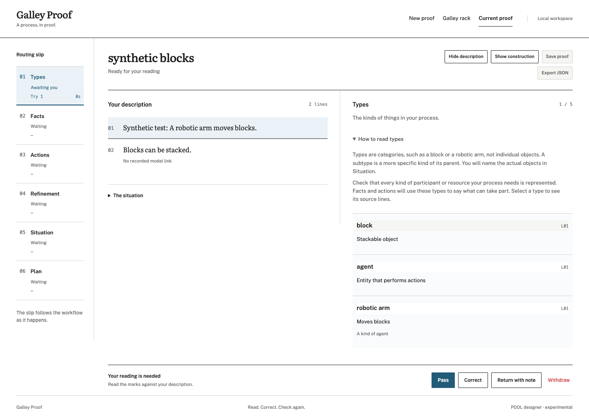
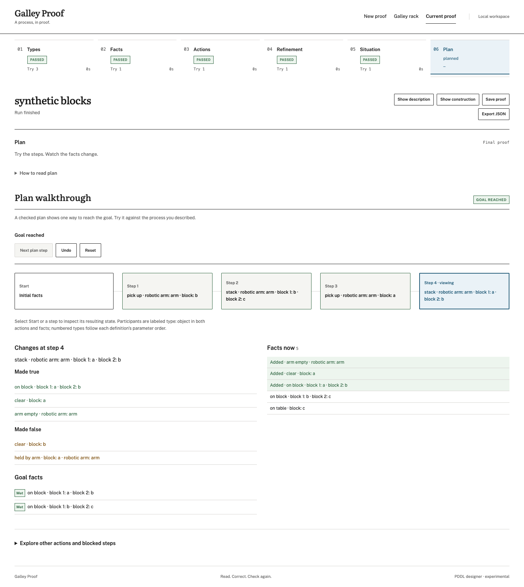

# MoltNet PDDL designer (experimental)

Turns an expert's process description into a planning domain, so the process
can be checked and, next, mapped onto an agent workflow. It runs on
[MoltNet](https://themolt.net) task primitives and depends only on published
packages (`@themoltnet/sdk`, `@themoltnet/tasks-orchestrator`).

Turns a natural-language process description into a typed planning domain,
renders it as PDDL, and checks it with a planner. Each extraction stage is a
contracted `freeform` MoltNet task, so the model returns structured data through
the validated submit tool instead of free text.

The design follows Acitelli et al., "Generating Domain Models for Automated
Planning from Natural Language Descriptions" (CAI 2026,
[code](https://github.com/giacomo1096/NL2PDDL)), with three changes found by
reproducing that pipeline:

See [related research](docs/RELATED-RESEARCH.md) for the source papers and
related work on temporal PDDL and domain generation.

| Paper                                                         | This library                                                                                                      |
| ------------------------------------------------------------- | ----------------------------------------------------------------------------------------------------------------- |
| BAML classes; preconditions and effects as free-text strings  | TypeBox schemas sent as `outputContract`; preconditions and effects are typed atoms                               |
| An LLM stage writes the PDDL text                             | `render.ts` renders PDDL from the typed result, deterministically                                                 |
| Evaluation by an LLM judge and experts; syntax check with VAL | `check.ts` runs cross-stage checks after every stage, and `planner.ts` searches for a plan on the combined result |

The planner check matters because every stage can return a schema-valid result
while the domain is still wrong. In the reproduction, the generated problem
declared no objects of the types the actions produce, so the goal was
unreachable. With those objects added, the planner's plan merged a second issue
by reusing the first issue's pull request and approval.

## Local wizard

Install the Node version in `.tool-versions`, then enable pnpm through Corepack:

```bash
corepack enable pnpm
pnpm install
pnpm dev
```

Open `http://127.0.0.1:4317`. The local server serves the UI and talks to
MoltNet; generation workers run separately (see [Runtime profiles](#runtime-profiles)).
For a built UI, run `pnpm build` followed by `pnpm start`. Saved proofs default
to `runs/`; override with `pnpm dev --runs-dir /path/to/proofs`.

Review extracted meaning alongside numbered source sentences, then Pass,
Correct, Return with note, or Withdraw. Description and construction are
independent Show/Hide panels. The screenshots below use the synthetic Blocks
World browser-test fixture; they demonstrate interaction, not model accuracy.



Step through the plan to inspect typed participants, changed facts and goal
conditions. The description starts collapsed here to give the walkthrough room.



An unfinished live run can be recovered from **Resume current run** on a fresh
page. At its review gate, continue reading or withdraw it before starting another
run. Live sessions last only as long as the local server process; save completed
proofs to reopen them after a restart. A worker-claim timeout explains which step
was not picked up and offers **Review setup and retry**. Generated corrections
cannot skip earlier saved edits that still need your approval.

### Source evidence

Code numbers description sentences; generation tasks receive that numbered
copy and request citations. Citations are model output: local checks reject
nonexistent sentence numbers, while you verify whether the cited text supports
the result. Missing citations remain visible and are not silently invented.
These checks also apply to CLI runs: invalid numbers can trigger the normal
automatic correction attempt. Numbering currently uses Node's `Intl.Segmenter`;
keep the Node/ICU version consistent when moving saved proofs between machines.

## Stages

| Stage        | Returns                                                  | Checked by                                                                                                                                              |
| ------------ | -------------------------------------------------------- | ------------------------------------------------------------------------------------------------------------------------------------------------------- |
| `types`      | Types, each with an optional parent                      | Undefined parents, cycles, the reserved root `object`                                                                                                   |
| `predicates` | Facts with typed parameters                              | Unknown parameter types, duplicates                                                                                                                     |
| `actions`    | Draft actions: parameters, preconditions, adds, deletes  | Unknown predicates, arity, non-parameter arguments, type mismatches. Hints: facts no action deletes, parameters no precondition links                   |
| `refine`     | Complete action list and one line per change             | Same as `actions`                                                                                                                                       |
| `problem`    | Objects, initial facts, and goal for the given situation | Undeclared objects; actions whose parameter type has no object; goal facts that can never become true, with the initial facts each blocked action lacks |

A result with errors gets one correction task listing the exact problems
(`--max-corrections`, default 1). Warnings from the draft actions are passed to
the refine stage as hints it applies only when the description supports them.

After the last stage, the planner grounds every action with the problem's
objects and runs two checks:

1. **Reachability, ignoring delete effects.** If a goal fact cannot become true
   even then, the problem is unsolvable. For each action that can never fire, it
   reports the facts that only the initial state could provide, such as an agent
   never marked free or a pool never made available. The problem stage gets the
   same report as errors before the plan check runs.
2. **Greedy best-first search** guided by the additive heuristic. It finds a
   valid plan quickly, but not necessarily a shortest one. States from which the
   goal is unreachable are pruned, so an exhausted search proves unsolvability.

`validatePlan` replays a given plan step by step. Use it to assert that an
intended plan works and that a known-bad plan is rejected.

## Output

`runPddlDesign` returns a `DesignRun` record:

- `status`: `planned`, `unsolvable`, `search_limit`, `invalid` (a stage still failed its checks after corrections), or `failed` (a task failed)
- `stages[]`: per attempt, the task id, the brief sent, the typed result, the findings, and the duration
- `domain`, `problem`: the typed IR
- `domainPddl`, `problemPddl`: the rendered PDDL
- `refinements`: what the refine stage reports changing
- `grounding[]`: concrete action count per action, and the parameter types with no objects
- `plan`: the steps, or why no plan was found
- `issues`: warnings left on the final domain and problem

A UI can render this record directly. Each stage record says whether a model
produced it (`source: 'task'`, with its `taskId`) or the reviewer edited it
(`source: 'edit'`).

## Progress and review gates

`runPddlDesign` takes two optional hooks:

- `onEvent` receives progress as it happens: `task-created`, `task-claimed`,
  `stage-result`, `stage-accepted`, `plan-checked`, `review`, `finished`. The
  CLI prints them on stderr.
- `confirmStage` is called when a stage result is ready: after it passes the
  checks, or once the automatic corrections are used up. It answers with one
  of these decisions:
  - `accept`: continue. Refused while the checks still report errors.
  - `edit`: replace the result. It is checked like a model result, schema
    first, and the gate asks again.
  - `feedback`: send another task for the stage, with the message as a
    correction.
  - `abort`: stop the run as `failed`, with the reason.

Without `confirmStage`, a passing result is accepted and a failing one stops
the run as `invalid`, as before.

## Limits

- The supported fragment is STRIPS with typing and negative preconditions. There are no quantifiers, conditional effects, or numeric fluents.
- The built-in planner is a checker for small models. Its default limits are 20,000 concrete actions and 100,000 states. For larger models, or for optimal plans, give the rendered PDDL to Fast Downward.
- The output contract cannot carry `pattern`, so naming rules are checked by the stage parsers after the daemon accepts a result. A naming error fails that stage's task outcome; it does not trigger a correction.

## Runtime profiles

`runtime/profiles/legreffier-pddl-designer-v1.json` is input-only. It
has no workspace and no network, and it binds the empty tool policy
`runtime/policies/legreffier-pddl-designer-input-only-v1.json`. Its
`pddl-modeling` skill carries the modeling rules shared by all stages. Each task
brief carries that stage's instructions and the earlier results.

The definitions are not applied automatically. Create them with the released
CLI:

```bash
moltnet policy create --from-file runtime/policies/legreffier-pddl-designer-input-only-v1.json --team-id "$TEAM"
moltnet profile create --from-file runtime/profiles/legreffier-pddl-designer-v1.json --team-id "$TEAM"
moltnet profile set-policies legreffier-pddl-designer-v1 --policy legreffier-pddl-designer-input-only-v1 --team-id "$TEAM"
moltnet profile allowed-tools legreffier-pddl-designer-v1 --team-id "$TEAM"
```

### Choose a default and override only where useful

A runtime profile selects a model and its generation settings, shared context,
tool policy, and sandbox. It is not a workflow step: each task carries its own
step instructions, output contract, and earlier results. One generation profile
can therefore serve all five modeling steps.

In the wizard, open **MoltNet connection**, enter a **Default generation profile
name or ID**, and expand **Choose profiles by step** for optional overrides.
Names and IDs must belong to the selected team. Empty overrides inherit the
default. The app resolves all selected profiles before creating modeling tasks.

| Wizard step            | CLI override           | What to optimize for                                    |
| ---------------------- | ---------------------- | ------------------------------------------------------- |
| Types                  | `--types-profile`      | Reliable extraction of entity kinds                     |
| Facts                  | `--predicates-profile` | Relationships and typed arguments                       |
| Actions                | `--actions-profile`    | Preconditions, add/delete effects, resource constraints |
| Refinement             | `--refine-profile`     | Reasoning across actions and repairing inconsistencies  |
| Situation              | `--problem-profile`    | Concrete objects, initial facts, and goals              |
| Plan and static checks | None                   | Deterministic local code; no model call                 |

Start with the supplied profile as a baseline. If actions or refinement need
more reliable reasoning, create a second profile from the supplied definition:
change its `name` and `models.generation` to a model/provider supported by your
runtime, then create it and bind the same input-only tool policy. Keep the
shared modeling context and output-submission instructions. No workspace,
network access, or additional tools are needed for these stages. The bundled
model is an experimental baseline, not a requirement or a quality guarantee.
Compare results on your own process descriptions before changing models.

For example, after creating a second profile named `pddl-reasoning`:

```bash
pnpm --silent cli \
  --description examples/issue-workflow/description.md \
  --problem examples/issue-workflow/situation.md \
  --team "$TEAM" --diary "$DIARY" \
  --profile legreffier-pddl-designer-v1 \
  --actions-profile pddl-reasoning --refine-profile pddl-reasoning \
  --out run.json
```

The library equivalent is `DesignInput.profileId` plus optional
`stageProfiles: { actions: reasoningProfileId, refine: reasoningProfileId }`.
Library callers pass resolved profile IDs; the wizard and CLI also accept names.
Corrections and retries use the profile selected for their modeling step.

### Start matching workers

Creating a profile does not start a worker. Your daemon must serve `freeform`
tasks for every selected generation profile in the same team. Run a worker for
each profile using your configured daemon identity (separate terminals/processes
when using `drain`):

```bash
moltnet-agent drain --profile legreffier-pddl-designer-v1
# In another terminal, when this profile is used by an override:
moltnet-agent drain --profile pddl-reasoning
```

To prefill the wizard's default connection:

```bash
pnpm dev --team "$TEAM" --diary "$DIARY" --profile legreffier-pddl-designer-v1
```

The local server also reads `MOLTNET_TEAM_ID`, `MOLTNET_DIARY_ID`, and
`MOLTNET_PROFILE_ID`; explicit flags take precedence. Profile references are
configuration, not credentials. Authentication stays on the server. Saved proofs
can be inspected and manually edited offline; asking for a generated correction
requires the selected workers again.

If a profile is **not found**, check its name/ID and team. If a step is **waiting
for a worker**, check that the daemon serves that exact profile and task type,
and that its team/correlation filters admit the run. If execution fails, check
provider credentials and model availability in the daemon environment. Granting
extra filesystem or network permissions is not a remedy for a routing problem.

Optional semantic review uses `--review --classify-profile` with a profile
configured for `models.classification` and a worker serving `classify` tasks.
This is separate from generation overrides and is currently CLI-only. See
[Plan review](#plan-review-optional); static validation remains authoritative.

## Writing the inputs

The inputs are a process description and a situation. Follow
[WRITING-DESCRIPTIONS.md](./WRITING-DESCRIPTIONS.md): it lists what to state
explicitly, with the live-run failure each rule prevents.
`examples/docs-review-guided` follows it; `examples/docs-review` is the same
process written without it.

## Run

Inspect the first stage's task without creating anything:

```bash
pnpm --silent cli \
  --description examples/issue-workflow/description.md \
  --problem examples/issue-workflow/situation.md --dry-run
```

Run all stages. An agent daemon must be draining `freeform` tasks for the same
team and profile, for example `moltnet-agent drain --profile legreffier-pddl-designer-v1`:

```bash
pnpm --silent cli \
  --description examples/issue-workflow/description.md \
  --problem examples/issue-workflow/situation.md \
  --domain-name issue-workflow --problem-name two-issues \
  --team "$TEAM" --diary "$DIARY" --profile legreffier-pddl-designer-v1 \
  --out run.json
```

The run prints a one-line status on stderr and writes the `DesignRun` to
`--out`.

### Plan review (optional)

`--review --classify-profile <profile>` re-plans without each step and asks
whether the description requires every step the planner can skip. Each question
is a `classify` task with one `bool` question, served by a profile whose
`models.classification` names a decision model; the task attempt's usage
records the provider and model that answered. A failed question fails the run rather than
passing the plan. A daemon must also be serving `classify` tasks for that
profile. Review is off by default: in live runs its findings have not yet
improved pass rates beyond run-to-run noise.

## Evaluation

`scripts/eval/lane.sh` runs examples repeatedly through `run-example.sh`, and
`scripts/score-runs.ts` scores the runs against each example's pre-registered
`required.json`:

```bash
TEAM=... DIARY=... RUNS_DIR=/tmp/runs PREFIX=e1 RUNS=10 \
  sh scripts/eval/lane.sh blocks-world docs-review
pnpm exec tsx scripts/score-runs.ts /tmp/runs e1 --json scores.json
```

`--examples <dir>` scores examples kept outside the repository.

## Development

```bash
pnpm install
pnpm test
pnpm typecheck
```

`pnpm-workspace.yaml` exempts `@themoltnet/*` from pnpm's release-age gate, so
a freshly published SDK installs immediately; every other dependency still
waits out the gate.

## License

AGPL-3.0-only. This code started in
[getlarge/themoltnet](https://github.com/getlarge/themoltnet) (`libs/pddl-designer`, PR #2726).

## Continuous integration and branch protection

Ready pull requests and pushes to `main` run ESLint, Secretlint, formatting checks, TypeScript
checks, unit/API tests, the production build, and browser tests using the Node version pinned in `.tool-versions`.
Draft PRs skip CI until marked ready. Browser tests use Playwright Chromium in
CI and installed Chrome locally; synthetic workers require no MoltNet secrets.
Failures upload traces, screenshots, and browser reports for seven days.

The proposed `Protect main` ruleset requires a pull request with one approval, resolved
review conversations, and the GitHub Actions `CI passed` check against an
up-to-date branch. New commits dismiss stale approvals. Force-pushes and branch
deletion are blocked, with no bypass actors. This ruleset is intended to replace
legacy branch protection; its configuration is tracked in
[.github/rulesets/main.json](.github/rulesets/main.json). Also enable automatic
deletion of merged PR branches in repository settings. Editing the JSON alone does not change
the live ruleset. Once CI is available, a repository administrator can create it
from a checkout containing this file:

```bash
gh api --method POST repos/getlarge/moltnet-pddl-designer/rulesets \
  --input .github/rulesets/main.json
gh repo edit getlarge/moltnet-pddl-designer --delete-branch-on-merge
```

Run the creation command once; use the existing ruleset ID to update it later.
The CI setup PR does not activate repository administration settings.

Before removing a development worktree, preserve ignored local proofs and
exports. Use `--runs-dir` with a persistent directory outside the worktree to
keep saved proofs independent of branch cleanup.

### Local lint checks

```bash
pnpm lint
pnpm secretlint
pnpm format:check
```

ESLint checks JavaScript and TypeScript with recommended rules, plus React hook
rules in the UI. Warnings fail the check. Secretlint uses its recommended preset
and scans text files, including dotfiles and workflow configuration. It uses the
repository's explicit `.secretlintignore` instead of inherited Git ignore rules;
dependencies, generated output, screenshots, and local runtime state are excluded.
For a deliberate fake credential in a fixture, use a rule-scoped
`secretlint-disable-next-line` comment with an explanation; do not disable the
scanner for the whole test directory. Use Node 24.14.1 or newer, matching the
minimum version in `package.json`.
