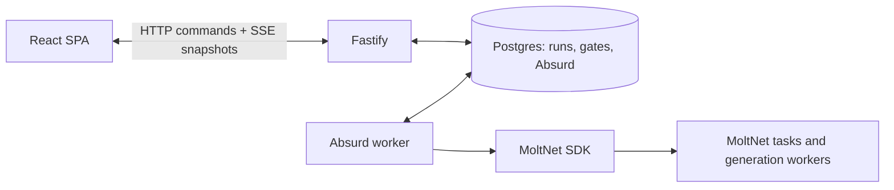

# Setup

The wizard and CLI need a MoltNet service and a worker that handles their
modeling tasks. Connect to an existing service or follow the official
[MoltNet self-host deployment guide](https://docs.themolt.net/deploy/docker-compose).
Run the commands below from this repository's root after configuring the
MoltNet CLI and agent daemon for your service. Set `TEAM` to the MoltNet team
ID and `DIARY` to the diary ID that will own the design tasks. The
[agent operations guide](https://docs.themolt.net/operate/running-agents)
covers daemon configuration and worker routing.

## Local database and worker

Install Docker and `uv` (providing `uvx`) for local database setup. From the
repository root, run `pnpm db:up`, set
`PDDL_DATABASE_URL=postgresql://designer@127.0.0.1:5440/designer`, then run
`pnpm db:init`. The initialization command explicitly initializes Absurd 0.4.0
and applies designer migrations; normal server startup never migrates a
database. Use a dedicated database. The Compose database accepts connections
only on loopback and uses trust authentication for local development. Use
authenticated connections for any non-local database.

### Durable runtime



The browser remains client-rendered; there is no SSR. It reads server-owned
snapshots and sends review decisions. Sharing state does not require rendering
HTML on the server. Credentials and MoltNet SDK calls stay in the worker process.
Fastify hosts only the HTTP API and UI; a separate process runs Absurd.
`pnpm dev` starts both and stops them together; `pnpm dev --offline` starts only
the server. Use `pnpm dev:server` and `pnpm worker` to run them independently.
The server does not need agent credentials. The CLI remains a single-process,
inline workflow and does not gain restart recovery from this change.

Absurd checkpoints task creation, terminal outcomes, profile resolution and
claim deadlines. Review decisions and their wake-up events commit in one database
transaction. Each gate generation can be decided once. A replacement worker
replays checkpoints after its predecessor's lease expires (up to about two
minutes by default), keeping external task creation idempotent. A database outage
pauses progress; reopening the browser does not reset the run. Exhausted engine
retries are shown as a stopped run and release the one-active-run limit.

**Withdraw running proof** stops orchestration even while waiting for a worker.
It does not cancel a generation task already dispatched to MoltNet; that task
may finish, but cannot advance the withdrawn proof. At a review gate, the existing
Withdraw action records the reviewer's decision and produces a stopped proof.

Keep the database volume (`moltnet-pddl-designer-data`) across restarts. Live
history currently has no automatic retention cleanup. Keep exported proofs in a
stable directory outside disposable worktrees, for example:

```bash
pnpm dev --runs-dir "$HOME/.local/share/moltnet-pddl-designer/runs"
# Saved proof viewing/editing without Postgres or an agent:
pnpm dev --offline --runs-dir "$HOME/.local/share/moltnet-pddl-designer/runs"
```

JSON import/export remains independent of the live database. Preserve both the
Postgres volume and exported files when moving installations. A run URL can
reopen its persisted result; saving it also adds it to the file-backed galley rack.
Do not replace workflow code underneath active runs with incompatible stage or
checkpoint changes: drain those runs first or introduce a versioned queue/handler.

Recovery tests use a dedicated provisioned test database and real worker process
kills, with persisted synthetic tasks instead of live MoltNet credentials:

```bash
PDDL_TEST_DATABASE_URL="$PDDL_DATABASE_URL" pnpm test:durable
```

## Runtime profiles

`runtime/profiles/legreffier-pddl-designer-v1.json` is input-only. It
has no workspace and no network, and it binds the empty tool policy
`runtime/policies/legreffier-pddl-designer-input-only-v1.json`. Its
`pddl-modeling` skill carries the modeling rules shared by all stages. Each task
brief carries that stage's instructions and the earlier results.

The definitions are not applied automatically. Create them with the released
CLI:

```bash
moltnet policy create --from-file runtime/policies/legreffier-pddl-designer-input-only-v1.json --team-id "$TEAM"
moltnet profile create --from-file runtime/profiles/legreffier-pddl-designer-v1.json --team-id "$TEAM"
moltnet profile set-policies legreffier-pddl-designer-v1 --policy legreffier-pddl-designer-input-only-v1 --team-id "$TEAM"
moltnet profile allowed-tools legreffier-pddl-designer-v1 --team-id "$TEAM"
```

### Choose a default and override only where useful

A runtime profile selects a model and its generation settings, shared context,
tool policy, and sandbox. It is not a workflow step: each task carries its own
step instructions, output contract, and earlier results. One generation profile
can therefore serve all five modeling steps.

In the wizard, open **MoltNet connection**, enter a **Default generation profile
name or ID**, and expand **Choose profiles by step** for optional overrides.
Names and IDs must belong to the selected team. Empty overrides inherit the
default. The app resolves all selected profiles before creating modeling tasks.

| Wizard step            | CLI override           | What to optimize for                                    |
| ---------------------- | ---------------------- | ------------------------------------------------------- |
| Types                  | `--types-profile`      | Reliable extraction of entity kinds                     |
| Facts                  | `--predicates-profile` | Relationships and typed arguments                       |
| Actions                | `--actions-profile`    | Preconditions, add/delete effects, resource constraints |
| Refinement             | `--refine-profile`     | Reasoning across actions and repairing inconsistencies  |
| Situation              | `--problem-profile`    | Concrete objects, initial facts, and goals              |
| Plan and static checks | None                   | Deterministic local code; no model call                 |

Start with the supplied profile as a baseline. If actions or refinement need
more reliable reasoning, create a second profile from the supplied definition:
change its `name` and `models.generation` to a model/provider supported by your
runtime, then create it and bind the same input-only tool policy. Keep the
shared modeling context and output-submission instructions. No workspace,
network access, or additional tools are needed for these stages. The bundled
model is an experimental baseline, not a requirement or a quality guarantee.
Compare results on your own process descriptions before changing models.

For example, after creating a second profile named `pddl-reasoning`:

```bash
pnpm --silent cli \
  --description examples/issue-workflow/description.md \
  --problem examples/issue-workflow/situation.md \
  --team "$TEAM" --diary "$DIARY" \
  --generation-profile legreffier-pddl-designer-v1 \
  --actions-profile pddl-reasoning --refine-profile pddl-reasoning \
  --out run.json
```

The library equivalent is `DesignInput.generationProfileId` plus optional
`stageProfiles: { actions: reasoningProfileId, refine: reasoningProfileId }`.
Library callers pass resolved profile IDs; the wizard and CLI also accept names.
Corrections and retries use the profile selected for their modeling step.

### Start matching workers

Creating a profile does not start a worker. Your daemon must serve `freeform`
tasks for every selected generation profile in the same team. Run a worker for
each profile using your configured daemon identity (separate terminals/processes
when using `drain`):

```bash
moltnet-agent drain --profile legreffier-pddl-designer-v1
# In another terminal, when this profile is used by an override:
moltnet-agent drain --profile pddl-reasoning
```

To prefill the wizard's default connection:

```bash
pnpm dev --team "$TEAM" --diary "$DIARY" \
  --generation-profile legreffier-pddl-designer-v1 \
  --classification-profile legreffier-pddl-classifier-v1
```

The local server also reads `MOLTNET_TEAM_ID`, `MOLTNET_DIARY_ID`,
`MOLTNET_GENERATION_PROFILE_ID`, and `MOLTNET_CLASSIFICATION_PROFILE_ID`;
explicit flags take precedence. Profile references are
configuration, not credentials. Authentication stays on the server. Saved proofs
can be inspected and manually edited offline; asking for a generated correction
requires the selected workers again.

If a profile is **not found**, check its name/ID and team. If a step is **waiting
for a worker**, check that the daemon serves that exact profile and task type,
and that its team/correlation filters admit the run. If execution fails, check
provider credentials and model availability in the daemon environment. Granting
extra filesystem or network permissions is not a remedy for a routing problem.

### Classification profiles

Source checks are enabled by choosing rules at the live **Actions review gate**,
previewing the request, and providing a classification profile there. There is
no intake toggle and no automatic source-check charge. Use this when a draft
prerequisite, effect, ownership link, or reusable fact needs interpretation
against the description. Local syntax and type checks need no decision model.

`runtime/profiles/legreffier-pddl-classifier-v1.json` supplies a separate
input-only profile with `models.classification` set to TypeSafe's `jev-latest`.
Generation profiles and per-step overrides do not select this model. Create it
and bind the existing empty tool policy:

```bash
moltnet profile create --from-file runtime/profiles/legreffier-pddl-classifier-v1.json --team-id "$TEAM"
moltnet profile set-policies legreffier-pddl-classifier-v1 --policy legreffier-pddl-designer-input-only-v1 --team-id "$TEAM"
moltnet-agent poll --team "$TEAM" --profile legreffier-pddl-classifier-v1 --task-types classify --workspace-strategy none
```

The worker needs a configured TypeSafe provider. No workspace tools or model
sandbox network access are required; the daemon calls
the provider. Keep the worker polling while you review stages. The wizard checks
that the profile belongs to the run's team and has a classification model before
creating a source-check task. Each explicit run has one attempt; a failure leaves
the draft available for review. The proof retains the exact request, returned
answers, task ID, elapsed time and available token usage.

With a TypeSafe API key in your shell, register the provider before starting
the worker (the key is stored in MoltNet's credential store):

```bash
printf '%s' "$TYPESAFE_API_KEY" | moltnet-agent providers set typesafe \
  --base-url https://api.typesafe.ai/v1 \
  --classifier-model jev-latest --classifier-api typesafe-system-one \
  --api-key-stdin
```

For a local classifier without TypeSafe credentials, use Ollama 0.35 or newer
and the supplied Nimble profile. The model is a separate download (about
5.6 GB for this quantization); it is not available through Ollama Cloud's
classification API. Configure MoltNet's local provider once:

```bash
ollama pull nimble:9b-q4_K_M
moltnet-agent providers set ollama --base-url http://127.0.0.1:11434/v1 \
  --classifier-model nimble:9b-q4_k_m --classifier-api typesafe-system-one
moltnet profile create --from-file runtime/profiles/legreffier-pddl-classifier-ollama-v1.json --team-id "$TEAM"
moltnet profile set-policies legreffier-pddl-classifier-ollama-v1 --policy legreffier-pddl-designer-input-only-v1 --team-id "$TEAM"
moltnet-agent poll --team "$TEAM" --profile legreffier-pddl-classifier-ollama-v1 --task-types classify --workspace-strategy none
```

Use `legreffier-pddl-classifier-ollama-v1` as the classification profile in the
wizard or CLI. The classifier returns a probability for a Boolean decision;
check a threshold against your own labeled cases before using it as a gate.

Optional **final plan review** uses `--review --classification-profile` in the CLI. It
asks whether a skippable step is required after plan search. This is separate
from the wizard's source checks. See [Plan review](../README.md#plan-review-optional).
