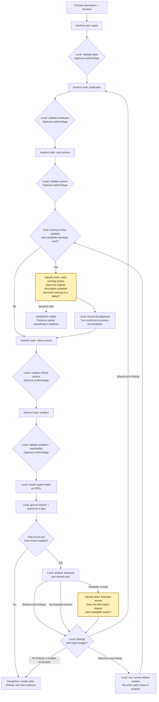

# PDDL designer workflow

The five extraction/refinement nodes are contracted MoltNet `freeform` tasks.
Rendering, validation, reachability, and planning run locally. The two yellow
nodes are MoltNet `classify` tasks, served by a classification profile.

Early review runs after draft acceptance and before refinement, so it sees
reviewer edits rather than a stale task result. It judges ownership/linking and
permanent-fact warnings. Confirmed concerns guide refinement; dismissed and
uncertain judgments stay in the audit record. This experiment does not change
final acceptance rules or discover entirely missing requirements.

Final review asks a different question: can a planner skip a step that the
process requires? Its local analysis also detects shared work without a
classifier. Findings can trigger bounded repairs to refinement or to predicates
and actions. The problem is reused only while it remains valid for the new
domain. PDDL is rendered whenever the corresponding typed model changes, so
the problem task also receives the rendered domain.

To keep the diagram readable, generation retry edges are omitted. Every
generation result passes schema and static checks. Automatic corrections are
bounded by `maxCorrections`; `confirmStage`, when supplied, can accept a valid
result, edit and recheck it, request a feedback task, or abort. Classification
cannot waive these checks. Early review has no separate semantic retry loop.
