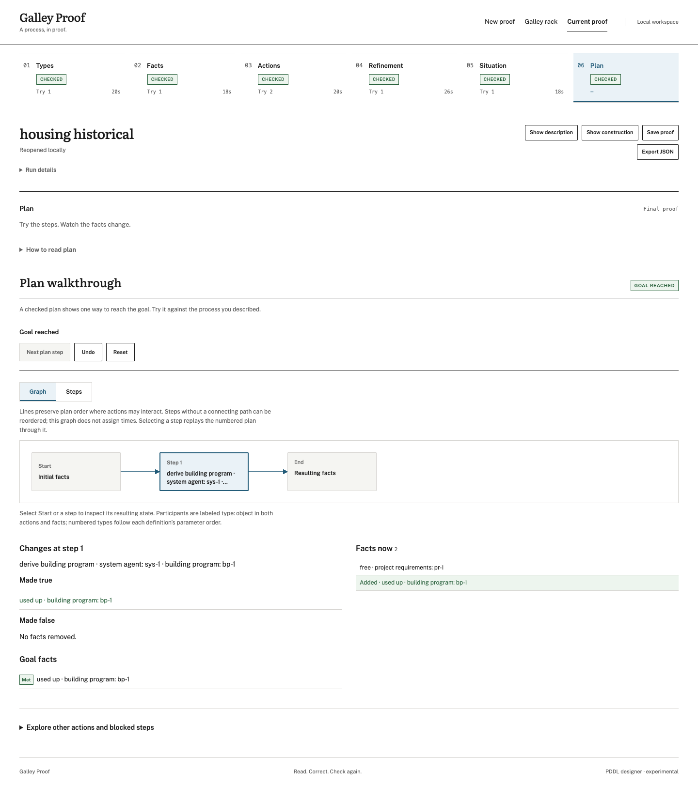

# Historical housing process experiment

This input asks what PDDL Designer derives from the earliest recorded housing workflow, before supplying later implementation lessons. description.md is a byte-for-byte copy of house-design-agents docs/workflow.md at 3491245, dated 2026-09-15. It is historical repository prose; original human authorship is not asserted. situation.md is newly authored synthetic input and is explicitly separate from that evidence.

The unchanged description retains its POC phases and benchmark caveat. Ambiguity is part of this baseline. No housing code, current instructions, client files or later constraints are model input. The ordinary generic PDDL modelling skill remains in the generation profile; this is not a recreation of September's model environment.

manifest.json pins input hashes, code revisions and the original correlation. profile.snapshot.json freezes the resolved existing profile: revision 2, Ollama Cloud gpt-oss:120b, temperature 0.1, output cap 8192. One automatic structural correction per stage is allowed. Optional final semantic review and temporal extraction are disabled. Keep first artifacts and failures unchanged; a clarified description is a new experiment.

## Run and preserve

Use the repo's installed dependencies and a verified signed macOS Agent bundle. Set MOLTNET_AGENT_BUNDLE_ROOT to that bundle, then run:

```sh
sh examples/housing-historical/run.sh /absolute/path/to/new-output-directory
```

The runner uses absolute paths because moltnet start may change cwd to its configured project binding. It serves only this correlation/profile/diary, uses the input-only generation profile, and stops its own worker on exit. Outputs must use an absolute path and must not already exist. This fixture pins the original correlation: duplicate experiments need a new manifest/correlation and a new output directory. Never overwrite the first result. No profile, policy or model setting is modified by this script.

## Interpretation

Review explicit historical rules separately from ambiguous or unstated conditions, later requirements and modelling limitations. A valid plan is not proof of business fidelity. An invalid model or planning failure is a recorded result, not a reason to rewrite the historical input. Generated action names require semantic inspection before using name-based coverage metrics. The original source already identifies the client brief and later supplied plan as different revisions; they must not be compared as generation ground truth.

The housing experience inventory remains a separate deliverable, in that repository's docs/research/experience-pddl-study. No shared schema, new experience convention or executor integration is introduced by this experiment.

## Inspect the saved proof

The unedited generated result and rendered PDDL are checked in under `baseline/`. Import `baseline/run.json` through the wizard, or serve a separate runs directory containing a copy named `housing-historical.json`. `baseline/validation.json` records replay checks. See [RESULTS.md](RESULTS.md) for the semantic failure; the UI status `planned` means executable under the generated model.



The screenshot shows the saved proof after one step: the generated goal is reached, although the described design and review process has not occurred. Captured from the local server with its durable worker running; no model regeneration or semantic edits were performed.
